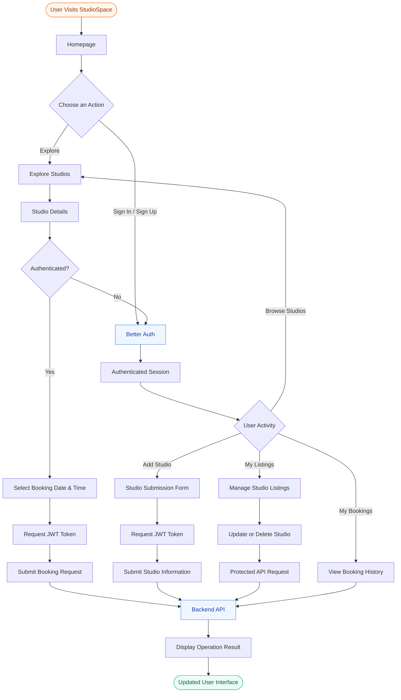

# StudioSpace

### Creative Workspace & Studio Booking Marketplace

<p align="center">
  <a href="https://studiospace-frontend-azure.vercel.app/">
    <strong>Explore Live Application ↗</strong>
  </a>
</p>

StudioSpace is a modern creative workspace marketplace that connects creators with professional studios and creative space owners. Users can discover workspaces, explore studio details, and book spaces according to their creative requirements. Studio owners can also publish their spaces and manage their listings through a personalized experience.

---

## 1. Project Overview

StudioSpace provides a centralized platform for discovering, listing, and booking creative workspaces.

The application focuses on two primary user experiences:

- **Creators:** Discover creative spaces, compare facilities, explore studio details, and book suitable workspaces.
- **Studio Owners:** Publish studio listings, manage workspace information, and maintain their personal listings.

## 2. Key Features

- **Studio Discovery:** Explore creative workspaces across multiple categories.
- **Category Exploration:** Browse Photo Studios, Film Stages, Podcast Rooms, Music Suites, and Art Workshops.
- **Studio Details:** View images, amenities, pricing, location, capacity, and host information.
- **Authentication:** Register and sign in using email/password or Google authentication.
- **Studio Listing:** Publish new creative spaces with detailed information.
- **Listing Management:** View, update, and delete personal studio listings.
- **Studio Booking:** Select preferred dates and time slots to book workspaces.
- **Booking Management:** View booking history, track statuses, and cancel eligible bookings.
- **Protected Operations:** JWT-based authentication for selected protected operations.
- **Responsive Interface:** Optimized layouts for desktop, tablet, and mobile devices.
- **Interactive Feedback:** Toast notifications, loading indicators, and confirmation dialogs.

## 3. Technology Stack

| Category | Technologies |
|---|---|
| Framework | Next.js (App Router) |
| UI Library | React |
| Language | TypeScript |
| Styling | Tailwind CSS |
| UI Components | HeroUI, DaisyUI |
| Authentication | Better Auth |
| API Communication | Fetch API |
| Token Authentication | JWT |
| Icons | React Icons |
| Carousel | Swiper.js |
| Notifications | React Toastify |
| Deployment | Vercel |

## 4. Project Architecture

The frontend follows a modular architecture using the Next.js App Router. Application routes, reusable components, authentication utilities, and TypeScript definitions are organized separately to improve maintainability and scalability.

### Application Working Flow



## 5. Project Folder Structure

```text
studiospace-client/
│
├── public/
│   ├── images/
│   ├── icons/
│   └── ...
│
├── src/
│   │
│   ├── app/
│   │   ├── api/
│   │   │   └── auth/
│   │   │       └── [...all]/
│   │   │           └── route.ts
│   │   │
│   │   ├── add-new-studio/
│   │   │   └── page.tsx
│   │   │
│   │   ├── explore-studios/
│   │   │   ├── page.tsx
│   │   │   ├── [id]/
│   │   │   │   └── page.tsx
│   │   │   └── edit/
│   │   │       └── [id]/
│   │   │           └── page.tsx
│   │   │
│   │   ├── my-listings/
│   │   │   └── page.tsx
│   │   │
│   │   ├── my-bookings/
│   │   │   └── page.tsx
│   │   │
│   │   ├── signin/
│   │   │   └── page.tsx
│   │   │
│   │   ├── signup/
│   │   │   └── page.tsx
│   │   │
│   │   ├── layout.tsx
│   │   ├── page.tsx
│   │   └── not-found.tsx
│   │
│   ├── components/
│   │   ├── navbar/
│   │   ├── footer/
│   │   ├── home/
│   │   ├── exploreStudios/
│   │   ├── addNewStudio/
│   │   ├── myListings/
│   │   ├── myBookings/
│   │   └── ...
│   │
│   ├── lib/
│   │   ├── auth.ts
│   │   ├── auth-client.ts
│   │   └── ...
│   │
│   └── Type/
│       └── ...
│
├── next.config.ts
├── package.json
├── tsconfig.json
└── README.md
```

### Directory Responsibilities

| Directory / File | Responsibility |
|---|---|
| `src/app/` | Application routes and page-level components |
| `src/app/api/auth/` | Authentication API handler |
| `src/components/` | Reusable UI components organized by feature |
| `src/lib/` | Authentication configuration and shared utilities |
| `src/Type/` | Shared TypeScript interfaces and types |
| `public/` | Static images, icons, and assets |
| `layout.tsx` | Root layout and shared application structure |
| `page.tsx` | Main homepage |
| `not-found.tsx` | Custom not-found page |
| `next.config.ts` | Next.js application configuration |

## 6. Application Routes

| Route | Description | Access |
|---|---|---|
| `/` | Homepage and featured studios | Public |
| `/explore-studios` | Explore available studios | Public |
| `/explore-studios/[id]` | Individual studio details | Public |
| `/explore-studios/edit/[id]` | Update studio information | Authenticated |
| `/add-new-studio` | Publish a new studio | Authenticated |
| `/my-listings` | Manage personal studio listings | Authenticated |
| `/my-bookings` | Manage personal bookings | Authenticated |
| `/signin` | User sign-in | Public |
| `/signup` | User registration | Public |

## 7. Application Workflow

### Authentication

1. Users register or sign in using supported authentication methods.
2. Better Auth validates credentials and establishes an authenticated session.
3. When a protected operation is requested, the frontend retrieves a JWT.
4. The token is sent through the Authorization header.
5. The server verifies the token before processing protected operations.
6. The frontend displays the operation result.

### Studio Exploration

1. Users visit the Explore Studios page.
2. The application retrieves available studio information.
3. Studio cards display relevant information such as category, rating, price, and location.
4. Users can explore studios by category.
5. Selecting a studio opens its dedicated details page.

### Studio Listing

1. An authenticated user opens the Add New Studio page.
2. The user completes the studio information form.
3. The application validates the submitted information.
4. A JWT is requested and included in the submission.
5. The studio listing is submitted for processing.
6. A notification communicates the result.

### Studio Management

1. Users access their personal listings.
2. Existing studio information can be viewed and edited.
3. The edit page loads the selected studio's information.
4. Updated information is submitted.
5. Users can also delete listings after confirming the action.
6. The listing interface refreshes to reflect the changes.

### Studio Booking

1. Users open an individual studio details page.
2. They select their preferred booking date and time.
3. The application validates the booking information.
4. An authenticated booking request is submitted.
5. The server verifies the request and checks for an existing pending booking.
6. Successful bookings are processed.
7. Users receive feedback about the booking result.

### Booking Management

1. Users navigate to My Bookings.
2. Their booking information is displayed.
3. Booking statuses are available for tracking.
4. Eligible bookings can be cancelled through the application.

## 8. Component Organization

| Component Group | Responsibility |
|---|---|
| Navbar | Main navigation and authentication actions |
| Footer | Shared footer and application information |
| Home | Hero slider, featured studios, categories, and homepage sections |
| Explore Studios | Studio cards and discovery interface |
| Studio Details | Workspace information and booking interface |
| Add New Studio | Studio submission form |
| My Listings | Personal studio management |
| My Bookings | Booking information and status management |

The application uses reusable components and shared TypeScript interfaces to maintain consistent UI patterns and improve code maintainability.

## 9. Installation & Local Development

### Prerequisites

- Node.js
- npm
- Git

### Clone the Repository

```bash
git clone <repository-url>
```

### Navigate to the Project

```bash
cd studiospace-client
```

### Install Dependencies

```bash
npm install
```

### Start Development Server

```bash
npm run dev
```

Open the application in your browser:

```text
http://localhost:3000
```

### Production Build

```bash
npm run build
```

### Run Production Build

```bash
npm run start
```

## 10. Design & User Experience

StudioSpace focuses on a clean, modern, and intuitive interface.

- Consistent visual hierarchy and typography.
- Reusable and maintainable component architecture.
- Responsive layouts across different screen sizes.
- Clear navigation and intuitive user interactions.
- Meaningful loading, success, and error feedback.
- Custom confirmation dialogs and notifications.

## 11. Future Enhancements

- Complete user reviews and ratings functionality.
- Advanced studio search and filtering.
- Online payment integration.
- Booking invoice generation.
- Wishlist and saved studios.
- Enhanced booking availability management.

## 12. Project Information

| Attribute | Details |
|---|---|
| Project Name | StudioSpace |
| Project Type | Creative Workspace Marketplace |
| Application | Frontend Web Application |
| Framework | Next.js |
| Language | TypeScript |
| Authentication | Better Auth |
| Styling | Tailwind CSS |
| Deployment | Vercel |

---

<p align="center">
  **StudioSpace**
  <br/>
  Find Your Space. Create Your Vision.
</p>